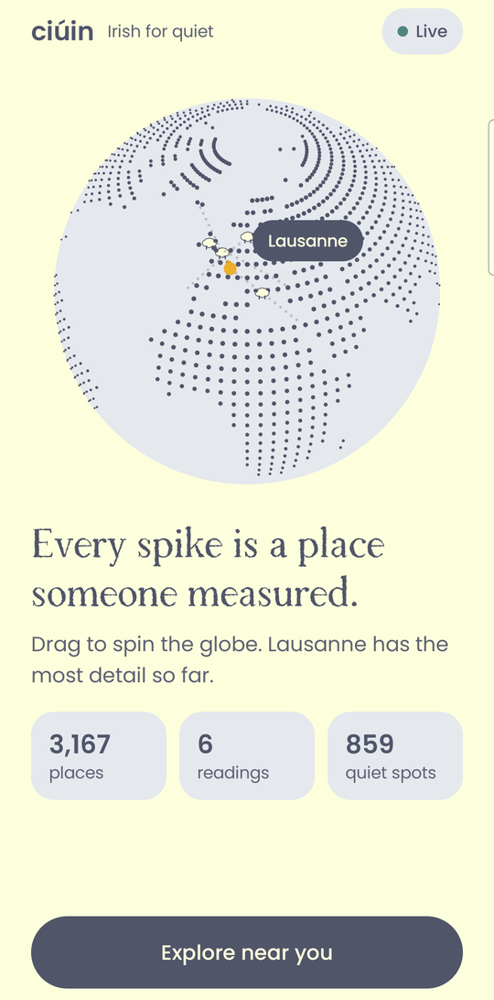
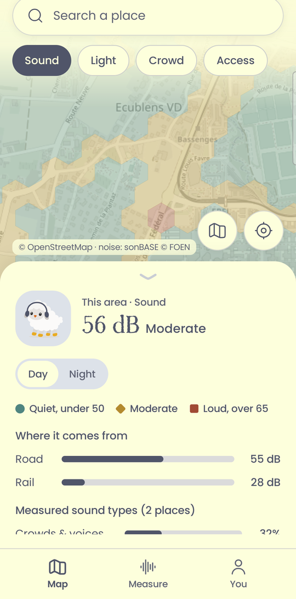
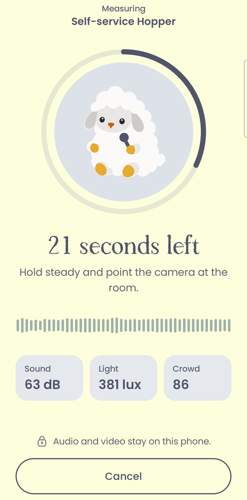
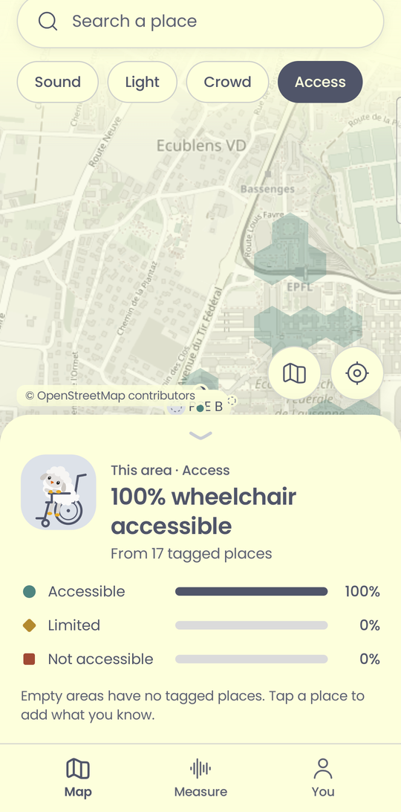
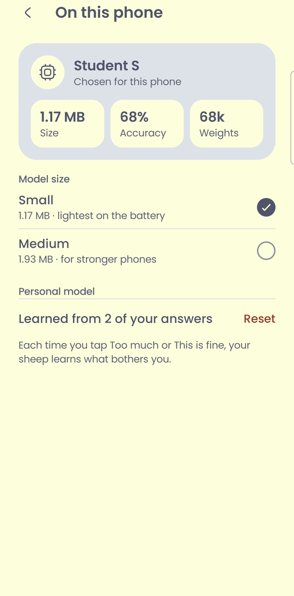
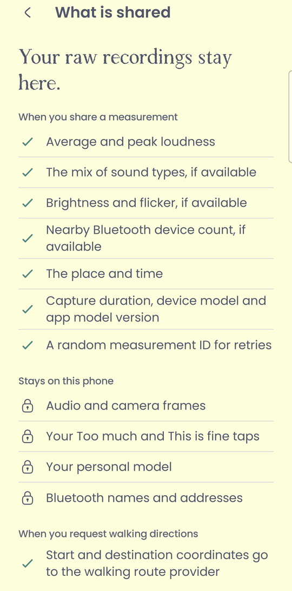

# Ciúin

**Ciúin** (Irish for *quiet*) is a calm sensory map for people who are easily overwhelmed by noise, light and crowds. It shows how loud, bright and busy places are, learns what bothers *you*, and helps you find somewhere calm nearby.

<p align="center">
  
  
  
  
</p>

**Android** is the demo app. **iOS** runs the same shared code and models. Both use the hosted backend on Railway, so there's nothing to set up.

## The problem

Many autistic and neurodivergent people, and people with ADHD, PTSD or migraine, plan their day around how a place will *feel*. A siren, a flickering light or a packed room can end it.

- **Up to 94%** of autistic adults report sensory processing differences ([Crane et al., 2009](https://pubmed.ncbi.nlm.nih.gov/19369385/)). About **1 in 127** people worldwide is autistic ([WHO, 2025](https://www.who.int/news-room/fact-sheets/detail/autism-spectrum-disorders)).
- In migraine, **up to 69%** of patients name visual discomfort as a trigger, and flicker is among the most aversive ([review](https://pmc.ncbi.nlm.nih.gov/articles/PMC4385011)).
- In Switzerland, **1 in 7** residents (about 1.1 million) live with daytime traffic noise above the legal limits ([FOEN](https://www.bafu.admin.ch/bafu/en/home/topics/noise/in-brief.html)).
- A Trinity College Dublin Disability Service survey found that **68%** of students had no quiet space on campus they could easily reach when overwhelmed, and over half simply leave campus.

Maps tell you opening hours, not that a café has a coffee grinder, flickering lights and a packed lunchtime. The open map barely records this: of **3,167 places in Lausanne**, **none** is tagged sensory-friendly on OpenStreetMap. So Ciúin measures it.

## What it does

- **A map of how places feel.** Sound, Light, Crowd and Access layers, each shown as calm / moderate / too much.
  - Sound starts from the official Swiss noise maps (road and rail, day and night).
  - Light, flicker and crowd come from people's measurements.
- **Measure a place in 30 seconds.** The phone listens, looks at the light and counts nearby Bluetooth devices, then shows you the readings before you share them.
- **A map that learns you.** You only ever answer *"too much"* or *"this is fine"*. A small personal model on your phone works out the shades in between, so everyone's map is different.
- **Get there calmly.** Tap any place to see how it feels for you, then *Take me there* for walking directions.
- **Calm by design.**
  - Soft colours, no flashing or pulsing.
  - Animation stops when the phone's reduce-motion setting is on.
  - Light and dark themes.
  - Every colour also comes with a shape and a word.

## How it works

| | |
|---|---|
| **On-device sound AI** | Recognises nine kinds of sound (sirens, construction, alarms, crowds and voices, music, traffic, dogs, machinery hum, other) entirely on the phone. A 4.3-million-parameter teacher (YAMNet + head) was distilled into students with **16× fewer parameters, under 2 MB**, keeping **98%** of the teacher's score. They run with LiteRT on Android *and* iOS. |
| **Frugal cascade** | A cheap loudness and change check runs on every second of audio, and the model only wakes up when something changes. Student S hands the windows it's unsure about (~15%) to Student M. In replays of real cafés, stations and squares, **no model ran 93% of the time**, and it still **noticed 86%** of sudden events (sirens, construction, alarms). |
| **Personal model** | A small model on the phone learns your triggers from *"too much"* / *"this is fine"* taps. In simulations, **ten taps cut its error by about 80%**. |
| **Light and flicker** | Brightness from the light sensor; flicker from camera frames (IES flicker index), up to 27 Hz: invisible, but a known migraine trigger. |
| **Crowd** | Distinct nearby Bluetooth LE devices above a signal-strength cut-off. Device addresses are never read or stored, only the count. |
| **Baseline data** | sonBASE road and rail noise (Swiss FOEN, 10 m rasters) and OpenStreetMap places, wheelchair access and opening hours. Estimated conditions for places nobody has measured yet. |
| **Privacy** | Audio, video and Bluetooth stay on the phone. Only the readings are shared, after you review them. Your taps and your personal model never leave the phone. |
| **Stack** | Kotlin Multiplatform and Compose Multiplatform (Android, iOS, desktop); FastAPI and SQLite on Railway. |

<p align="center">
  
  
</p>
<p align="center"><sub>Left: the sound model running on the phone and what the personal model has learned. Right: exactly what is shared, and what never leaves the phone.</sub></p>

## Try it

```sh
./gradlew :composeApp:installDebug     # Android phone or emulator; talks to the hosted backend
open iosApp/iosApp.xcodeproj           # iOS (macOS): pick a simulator or device, run iosApp
./gradlew :composeApp:run              # desktop window
```

Backend: <https://ciuin-production.up.railway.app> (API docs at [`/docs`](https://ciuin-production.up.railway.app/docs)).

## Team

| | |
|---|---|
| **Siddhi** | Data and backend, integration |
| **Christine** | Integration and UX |
| **Paramveer** | iOS and UI development |
| **Emma** | Machine learning: sound classifier, distillation, cascade, personal model |

Everything we reused (models, datasets, libraries, prior work) is listed in [`REUSED.md`](REUSED.md). Plan and contracts: [`Claude/todo.md`](Claude/todo.md).

---

# Developer guide

Kotlin Multiplatform (Android + Desktop + iOS). Plan and contracts: [`Claude/todo.md`](Claude/todo.md). Third-party material: [`REUSED.md`](REUSED.md).

| Folder | What |
|---|---|
| `composeApp/` | Compose Multiplatform UI (Android + Desktop + iOS) |
| `shared/` | KMP library: contracts (`commonMain`), platform code, tests |
| `backend/` | FastAPI server |
| `data/` | Data pipeline scripts; `raw/` is local only, `processed/` is committed |
| `ml/` | Audio model training |

## Setup

The team uses macOS (Emma, Paramveer) and Windows (Siddhi, Christine). Commands differ only where shown.

**Needs:** JDK 17+ (21 is fine), the Android SDK, Python 3.12.

| | macOS | Windows |
|---|---|---|
| JDK | `brew install --cask temurin@21`, or Android Studio's bundled JDK | Temurin 21 installer, or Android Studio's bundled JDK |
| Android SDK | Install Android Studio; open the project once (it writes `local.properties`), or `export ANDROID_HOME=~/Library/Android/sdk` | Android Studio, or set `ANDROID_HOME` to `%LOCALAPPDATA%\Android\Sdk` |
| Python | `python3` (macOS has no `python` by default) | `python` |
| venv activate | `source .venv/bin/activate` | `.venv\Scripts\activate` |
| venv's python | `.venv/bin/python` | `.venv\Scripts\python` |

### App
```sh
./gradlew :composeApp:run              # desktop window (Windows: gradlew.bat or .\gradlew)
./gradlew :composeApp:installDebug     # Android, with an emulator or phone connected
open iosApp/iosApp.xcodeproj           # iOS on macOS: select a simulator and run iosApp
./gradlew :shared:desktopTest          # contract tests
```
The first build downloads Gradle and dependencies (a few minutes).

Both mobile apps use the Student S and M models in `ml/export` for sound classification while measuring. Xcode resolves Google's pinned LiteRT package on the first iOS build. The `iosApp` scheme tests both bundled models against the repository's reference audio clips.

**Which backend the app talks to:** all targets default to the hosted backend, <https://ciuin-production.up.railway.app>.
| Target | Override |
|---|---|
| Desktop | `CIUIN_API_URL=http://localhost:8000 ./gradlew :composeApp:run` |
| Android | `./gradlew :composeApp:installDebug -Pciuin.apiUrl=http://10.0.2.2:8000` (a backend on your laptop, seen from the emulator) |
| iOS Simulator | Set `CIUIN_API_URL` in the Xcode scheme's Run environment, or override the build setting |

Use `fake` as the URL to run on the 5 sample places without a backend. When the configured backend is unreachable, the map shows bundled Lausanne places and an offline badge. The sample places are a backup if the bundle is missing.

On Android and iOS, requesting walking directions sends the start and destination coordinates to [FOSSGIS pedestrian routing](https://routing.openstreetmap.de/about.html), which logs route requests. On Android, use `-Pciuin.walkingRouterUrl=https://your-router.example` to point to your own pedestrian OSRM instance or `-Pciuin.walkingRouterUrl=` for straight-line routes only.

Live end-to-end test (writes a measurement, so use a throwaway DB):
```sh
cd backend && CIUIN_DB=/tmp/e2e.db uvicorn main:app --port 8000      # terminal 1
CIUIN_LIVE_API=http://localhost:8000 ./gradlew :shared:desktopTest --tests '*LiveTest'   # terminal 2
```

### Verify Android audio classification

With a booted emulator or device, run the bundled Student S and M models through the same extractor that powers measurements and listening:

```sh
./gradlew :composeApp:installDebug :composeApp:installDebugAndroidTest
adb shell am instrument -w ch.ciuin.app.test/ch.ciuin.app.listener.StudentModelVerification
```

The runner checks the app’s model file hashes and compares all nine scores against independent CPU LiteRT results for the tracked WAV fixtures. Each fixture uses its first second at 16 kHz, with zeros padding shorter clips. The app’s usual silence gate skips the tenth clip. A passing run reports `INSTRUMENTATION_CODE: -1`.

### Backend
```sh
cd backend
python3 -m venv .venv && source .venv/bin/activate     # Windows: python -m venv .venv; .venv\Scripts\activate
pip install -r requirements.txt
uvicorn main:app --reload --host 0.0.0.0 --port 8000
```

### Data pipeline
Scripts in `data/scripts/`. The `fetch_*` / `count_*` scripts need only the standard library; raster work needs `data/requirements.txt`.
```sh
python3 data/scripts/count_tags.py            # tag counts per tier → data/processed/tag_counts.json
python3 data/scripts/fetch_osm_lausanne.py    # → data/raw/osm_lausanne.json
python3 data/scripts/fetch_sonbase.py         # ~730 MB → data/raw/sonbase/
python3 -m venv data/.venv && data/.venv/bin/pip install -r data/requirements.txt
data/.venv/bin/python data/scripts/check_sonbase.py
```
On Windows use `python` and `data\.venv\Scripts\...` instead.

## Windows notes

These only matter on Windows when the repo path contains non-ASCII characters (e.g. `Ciúin`). They're already handled; don't remove them:
- `gradle.properties`: `android.overridePathCheck=true` and `-Dfile.encoding=COMPAT`.
- `data/scripts/raster_env.py`: import before `rasterio`.

## Committing
- `gradlew` and `*.sh` must keep LF line endings (enforced by `.gitattributes`).
- Never commit `data/raw/`, `*.db`, `.env` (tokens) or model files over 50 MB; run `sh scripts/ignore-large-models.sh` before committing exports.
